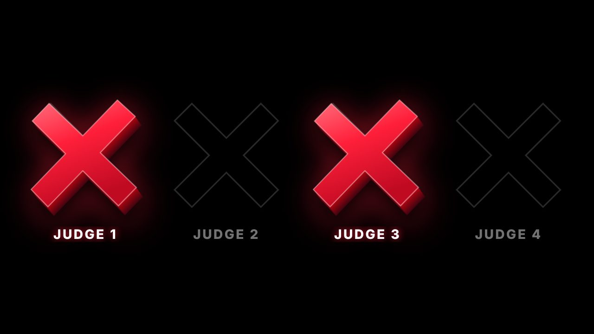
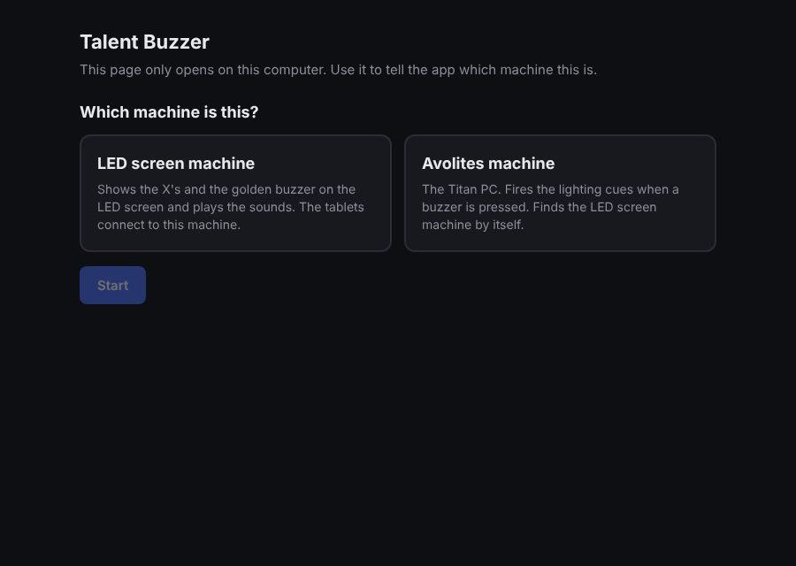
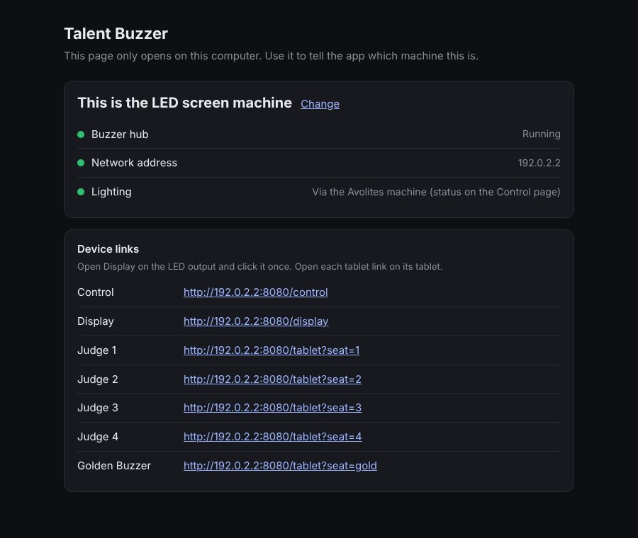
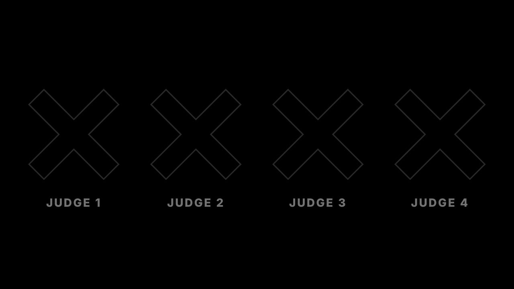
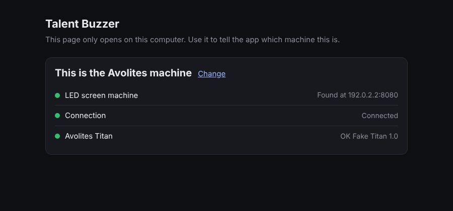
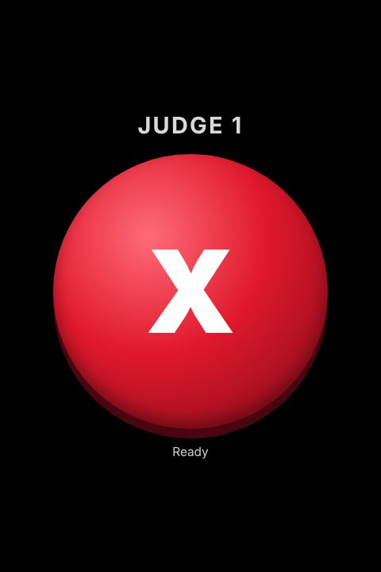
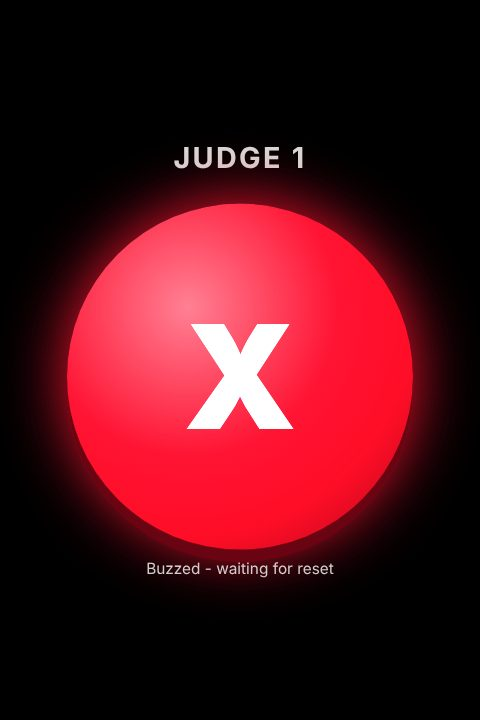
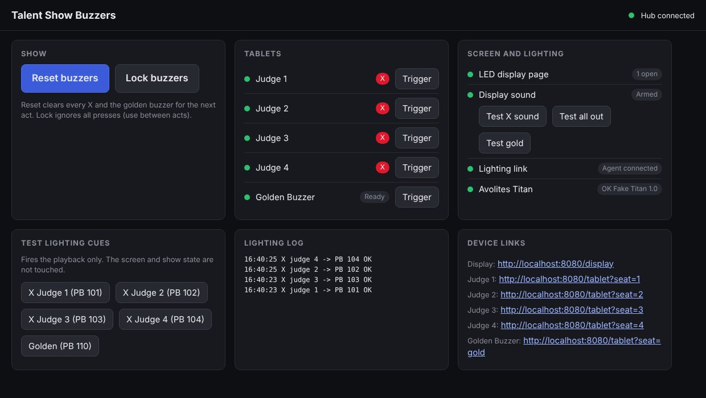
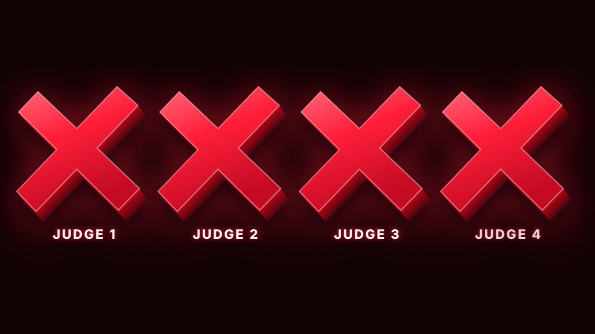

# Talent Show Buzzers

Judges press an X on a tablet, and three things happen at once:

1. An **X** pops up on the LED screen above that judge's name.
2. A **sound** plays through the speakers.
3. The **stage lights** change.

There are two styles, picked on the Control page (see [Celebrate or buzzer](#celebrate-or-buzzer)):

- **Celebrate (the default):** a judge presses when they love something about the act (they say what out
  loud), and their X lights up gold with a chime and a burst of confetti. The aim is for every act to
  light every X. When they do, the screen shouts **X-TRAORDINARY!** with a fanfare and confetti.
- **Buzzer:** the original red X that means "no", with a buzzer sound and a red alarm when every judge buzzes.

There is also one **golden buzzer**. When it's pressed, the whole screen turns gold, gold confetti
falls, a fanfare plays, and the lights do something special.

There can be **2, 3 or 4 judges**. Pick the number on the Control page (see [Judges' names and how many](#judges-names-and-how-many)).



---

## Downloads (everything you need, in one place)

Click these links on the computers. You don't need to search for anything.

| What | Link | Where it goes |
| --- | --- | --- |
| **Talent Buzzer app** (a small ZIP, about 0.5 MB) | [Download talent-buzzer.zip](https://github.com/SquareMediaGroup/destinychurch/releases/download/talent-buzzer/talent-buzzer.zip) | Both computers |
| **Node.js** for Windows (free, the engine the app runs on) | [Download the Node.js installer for Windows](https://nodejs.org/dist/v24.22.0/node-v24.22.0-x64.msi) | Windows computers |
| **Node.js** for Mac (the same thing, for a Mac) | [Download the Node.js installer for Mac](https://nodejs.org/dist/v24.22.0/node-v24.22.0.pkg) | The LED screen computer, if it's a Mac |
| **Google Chrome** for the tablets (usually already installed) | [Chrome on Google Play](https://play.google.com/store/apps/details?id=com.android.chrome) | All 5 tablets |

> If neither Node.js link suits the computer (for example a Windows ARM laptop), use the
> [Node.js download page](https://nodejs.org/en/download) and pick the **LTS** installer for that computer.
>
> If the app link ever says "Not Found", use the [download page for all versions](https://github.com/SquareMediaGroup/destinychurch/releases/tag/talent-buzzer),
> or, as a last resort, [download all of the church code](https://github.com/SquareMediaGroup/destinychurch/archive/refs/heads/main.zip)
> (a big file, about 180 MB) and use the `apps\talent-buzzer` folder inside it.

---

## How it fits together

```
   4 red tablets  ─┐
                   ├── Wi-Fi ──>  LED SCREEN COMPUTER  ──>  big screen + speakers
   1 gold tablet  ─┘                    │
                                        └── network ──>  AVOLITES COMPUTER  ──>  stage lights
```

- The **tablets** are the buttons.
- The **LED screen computer** is the brain. It shows the X's and plays the sounds.
- The **Avolites computer** (the lighting desk computer) changes the lights when the brain tells it to.

You put the **same app** on both computers. When it starts, it asks which computer it's on.

---

## What you need

Tick these off before you start:

- [ ] The **LED screen computer** (Windows or Mac), plugged into the big screen and the speakers
- [ ] The **Avolites computer** (Windows, running Titan)
- [ ] **5 Android tablets**, charged, with their chargers
- [ ] All of them on the **same Wi-Fi / network**
- [ ] **Internet** on both computers for the downloads (only needed once)
- [ ] About **30 minutes**, plus 5 minutes with whoever runs the lights

> **Tip:** Do the setup the day before the show, not five minutes before doors open.

---

## Part 1: Set up the LED screen computer

Do this on the computer that is plugged into the big LED screen.

**1. Install Node.js** (the engine the app runs on)

1. Click this link: **[Download the Node.js installer for Windows](https://nodejs.org/dist/v24.22.0/node-v24.22.0-x64.msi)**. A file downloads.
2. Open the downloaded file (it's in your **Downloads** folder). Click **Next**, **Next**, **Next**,
   then **Install**, then **Finish**. You don't need to change anything.
   - If it asks *"Do you want to allow this app to make changes?"*, click **Yes**.
   - If it offers to install "Tools for Native Modules", leave that box **unticked**. It isn't needed.

> **On a Mac**, use **[the Node.js installer for Mac](https://nodejs.org/dist/v24.22.0/node-v24.22.0.pkg)** instead.
> Open it from **Downloads**, click **Continue** until you reach **Install**, type the Mac's password, then **Close**.

> Already have Node.js? That's fine, as long as it's version 20 or newer. If it's too old,
> `start.bat` tells you and opens the download page for you.

**2. Get the app**

1. Click this link: **[Download talent-buzzer.zip](https://github.com/SquareMediaGroup/destinychurch/releases/download/talent-buzzer/talent-buzzer.zip)**.
2. Find **`talent-buzzer.zip`** in your **Downloads** folder. Right-click it and choose **Extract All**, then **Extract**.
3. A new window opens with a folder called **`talent-buzzer`** inside. Drag that folder onto the **Desktop**.

> **On a Mac**, just double-click `talent-buzzer.zip` in **Downloads**. A `talent-buzzer` folder appears next to it.
> Drag that folder onto the **Desktop**.

**3. Start the app**

1. Open the `talent-buzzer` folder on the Desktop.
2. Double-click **`start.bat`**. (If your computer hides file endings, it's just called **start**, with a cog icon.)
   - If a blue box says *"Windows protected your PC"*, click **More info**, then **Run anyway**.
   - If it says *"Node.js is not installed"*, go back to step 1.
3. A black window opens. **Leave this black window open**, because closing it stops the buzzers.
4. If a box says *"Windows Defender Firewall has blocked some features"*:
   tick **Private networks**, then click **Allow access**.
   This is important: without it the tablets can't connect.

> **On a Mac**, double-click **`start.command`** instead of `start.bat`. A Terminal window opens: leave it open.
> - If the Mac says it *"could not verify start.command"* or it's *"from an unidentified developer"*, click **Done**
>   (or **OK**). Then open **System Settings**, go to **Privacy & Security**, scroll down, and click **Open Anyway**
>   next to `start.command`. Click **Open Anyway** again, then type the Mac's password if it asks. You only need to do this once.
> - If it asks *"Do you want the application node to accept incoming network connections?"*, click **Allow**.
>   Without it the tablets can't connect.

**4. Tell it which computer this is**

A page opens in the web browser by itself. (If it doesn't, click **[http://localhost:8090](http://localhost:8090)**.
That link only works on a computer where `start.bat` or `start.command` is running.)



1. Click **LED screen machine**.
2. Click **Start**.

**You should see** green dots and a list of **Device links**:



Keep this page open. You'll need these links for the screen, the tablets and the control page.

> **Next time**, just double-click `start.bat` (or `start.command` on a Mac). It remembers that this is the LED screen computer.

---

## Part 2: Put the X's on the big screen

On the LED screen computer:

1. On the setup page, click the **Display** link. It opens in a new tab.
2. Drag that browser window onto the **big LED screen**.
3. **Click once anywhere on it.** This switches the sound on, because browsers won't play sound
   until you click.
4. Press **F11** on the keyboard so it fills the whole screen.

**You should see** a faint X outline for each judge (four unless you chose fewer), with their names underneath.
The page fits itself to the screen: on a short, wide LED wall the X's get smaller so they and the
names always fit, and on a tall one they stay centred.



---

## Part 3: Set up the Avolites computer

On the lighting computer (the one running Titan):

1. **Check the lighting desk can be controlled.** On this computer, click this link (or copy it into the web browser):
   **[http://localhost:4430/titan/get/System/SoftwareVersion](http://localhost:4430/titan/get/System/SoftwareVersion)**

   **You should see** a version number, like `"15.0"`. If you see an error, ask the lighting person
   to make sure Titan is open and running.
2. Do **Part 1, steps 1–3** on this computer too (install Node.js, copy the folder, double-click `start.bat`,
   allow the firewall with **Private networks** ticked).
3. When the setup page opens, click **Avolites machine**, then **Start**.
   Leave the boxes empty, because it finds the LED screen computer by itself.

**You should see** three green dots:



| Dot | What it means |
| --- | --- |
| LED screen machine: **Found** | It found the LED screen computer on the network |
| Connection: **Connected** | The two computers are talking |
| Avolites Titan: **OK** | It can control the lights |

---

## Part 4: Set up the 5 tablets

Do this on **each** tablet.

1. Connect the tablet to the **same Wi-Fi** as the computers.
2. Open **Chrome**. (Not on the tablet? Get it from [Chrome on Google Play](https://play.google.com/store/apps/details?id=com.android.chrome).)
3. Type the tablet's link into the address bar. Copy it **exactly** from the **Device links** list on the
   LED screen computer, for example:

   | Tablet | Link (yours will have different numbers) |
   | --- | --- |
   | Judge 1 | `http://192.168.1.50:8080/tablet?seat=1` |
   | Judge 2 | `http://192.168.1.50:8080/tablet?seat=2` |
   | Judge 3 | `http://192.168.1.50:8080/tablet?seat=3` |
   | Judge 4 | `http://192.168.1.50:8080/tablet?seat=4` |
   | Golden | `http://192.168.1.50:8080/tablet?seat=gold` |

   > **Shortcut:** type just `http://192.168.1.50:8080/tablet` (with your numbers) and tap the judge's name from the list.

4. Tap the **⋮** menu (top right), then **Add to Home screen**, then **Add**.
   Close Chrome and open the new icon. Now there's no address bar in the way.
5. **Stop the screen going to sleep:** Settings → Display → **Screen timeout** → pick the longest time.
6. *(Optional)* **Pin the screen** so judges can't leave the buzzer by accident:
   Settings → Security → **App pinning** → On.

**You should see** a big button with **Ready** underneath:

| Red judge tablet | Golden tablet | After pressing |
| --- | --- | --- |
|  |  |  |

> **Stick a label on the back of each tablet** ("Judge 1", "Judge 2", ... "GOLDEN") so they don't get mixed up.

---

## Part 5: Ask the lighting person

The lighting person needs to make the "looks" for each buzzer. Show them this part.

> **For the lighting person:** record each look as a **playback** in Titan and give it a **user number**.
> When a buzzer is pressed, the app fires that playback at full, as if you'd pressed it. You can still
> take over by hand. When **Reset** is pressed, the app turns those playbacks off again.

| Look | Example user number |
| --- | --- |
| Judge 1 buzzes | 101 |
| Judge 2 buzzes | 102 |
| Judge 3 buzzes | 103 |
| Judge 4 buzzes | 104 |
| All judges have buzzed (e.g. red strobe), optional | 120 |
| Golden buzzer | 110 |

If they use **different numbers**, change them on the **Control page** (the **Control** link on the setup page):

1. In the **Lighting cues** box, type each playback number next to its buzzer. Leave a box empty to fire nothing.
2. Pick what it does:
   - **Go** fires the playback (like pressing its Go).
   - **Flash** or **Swop** presses that button. For Flash, flash must be turned on for that playback in Titan.
   - **Fader** moves the playback's fader to the level you type (0 to 100%).
3. Set **times in seconds**, for example `5 times in 5 s`. Once (`1`) means Go, Swop and Fader stay on until Reset.
   More than once means it pulses on and off that many times, spread evenly over those seconds.
4. Click **Test** next to any of them to check the right look comes up.
5. Click **Save cues**. The buzzers use the new settings straight away, and the app remembers them next time.

To fire **any** playback at any time (for example a look that isn't on a buzzer), fill in the
**Fire any playback** box the same way and click **Fire**. Click **Off** to undo it.

> **Rehearse with the real desk first.** Go and Kill have been used before; Flash, Swop and Fader use the
> commands from Avolites' Web API notes and need checking on your console. If one does nothing, the
> **Lighting log** on the Control page says why.

> **Judges' names:** see [Judges' names and how many](#judges-names-and-how-many) below.

---

## Part 6: Test everything (5 minutes)

On the LED screen computer, click the **Control** link on the setup page. This is the operator's page.
You can also open it on a laptop or phone that's on the same Wi-Fi.



Go through this list:

1. [ ] **Tablets:** five green dots. (A red dot means that tablet isn't connected.)
2. [ ] **LED display page:** green. **Display sound** says **Armed**.
   If it says *"Click the display page once"*, click the big screen.
3. [ ] **Lighting link** and **Avolites Titan:** both green.
4. [ ] Click **Test X sound**, **Test all out** and **Test gold**. You hear them through the speakers.
5. [ ] In **Lighting cues**, click each **Test** button. The right look comes up each time.
6. [ ] Press each tablet once. Check the X appears, the sound plays and the lights change.
7. [ ] Click **Reset buzzers**.
8. [ ] Click **Lock buzzers** until the first act starts.

All done? **You're ready for the show!**

---

## Celebrate or buzzer

On the Control page, in the **Show** box, pick the **Style**:

- **Celebrate (X-traordinary):** gold X's, a chime and confetti for each X, and an **X-TRAORDINARY!** party
  when every X is lit. The judges say what they loved, so the screen shows only their names.
- **Buzzer (red X means no):** the original red X's, buzzer and red alarm.

The change shows straight away and is saved. Each style keeps its own sounds, so a buzzer sound you uploaded
for Buzzer never plays in Celebrate. **Tell the lighting person** if you switch: the looks for each X and for
"all X's lit" should feel like a celebration, not a red alarm.

## Change the sound effects

You can swap any of the three sounds for your own: the judge's X sound, the all-X's sound and the
**Golden buzzer** fanfare. The Sounds box changes the sounds for the style you're using.

1. Get the sound file onto the computer you have the Control page open on. MP3, WAV or M4A all work
   (up to 20 MB). Trim any silence at the start, or the sound will lag behind the X.
2. On the Control page, find the **Sounds** box.
3. Next to the sound you want to change, click **Choose file** and pick your file.
4. Click **Play**. You hear the new sound through the LED screen computer's speakers.

The screen uses the new sound straight away, with no refresh needed. It is kept when the app restarts and when you
download a new version. **Built-in** puts the original sound back.

## Judges' names and how many

**Names:** on the Control page, in the **Show** box, type each judge's name (and a name for the golden
buzzer), then click **Save names**. The big screen, the tablets and the Control page change straight away,
and the names stay after a restart.

**How many:** there can be 2, 3 or 4 judges. In the same box, pick the number next to **Number of judges**.

- The screen shows that many X's, spread across the width.
- The all-X's moment (party or red alarm) happens when **all of those** judges have pressed.
- Judges are used in order: with 3 judges, the Judge 4 tablet says **Not in use** and does nothing.
- Changing the number clears the buzzers, so do it before the show or between acts.
- The choice is saved and stays after a restart. Each judge's lighting cue is kept for when you add them back.

## During the show

| Button (on the control page) | What it does |
| --- | --- |
| **Reset buzzers** | Clears all the X's and the gold screen, and turns the buzzer lights off. **Press it between every act.** |
| **Lock buzzers** | Tablets stop working until you press **Unlock**. Use it between acts so nobody presses by accident. |
| **Trigger** | Presses that judge's buzzer for them, in case a tablet dies. |

What the audience sees:

| What happens | On the screen |
| --- | --- |
| A judge presses | Their X pops out of the screen (Celebrate: in their colour, with a chime and confetti; Buzzer: red, with a buzz). It stays until Reset. Pressing again does nothing. |
| Every judge presses | Celebrate: **X-TRAORDINARY!**, a fanfare and confetti until Reset. Buzzer: the screen flashes red with an alarm, then glows red until Reset. |
| Golden buzzer | Gold screen, falling confetti, fanfare. Works once until Reset. |




**The order for each act:**
1. **Unlock** buzzers when the act starts.
2. Judges buzz (or not!).
3. **Reset**, then **Lock** when the act finishes.

---

## Uh oh! Something's wrong

| Problem | Try this |
| --- | --- |
| Tablet says **"Not connected - reconnecting..."** | Is the tablet on the same Wi-Fi as the computers? Is the black `start.bat` window still open on the LED screen computer? Is the link typed exactly right? |
| Black window says **"Node.js is not installed"** or **"old version of Node.js"** | Install Node.js with the [Node.js installer link](https://nodejs.org/dist/v24.22.0/node-v24.22.0-x64.msi), then double-click `start.bat` again. |
| **No tablets can connect at all** | On the LED screen computer, Windows Firewall is probably blocking it. Search the Start menu for **"Allow an app through Windows Firewall"**, find **Node.js**, and tick **Private**. On a Mac, open **System Settings**, go to **Network**, then **Firewall**, then **Options**, and set **node** to **Allow incoming connections**. |
| **No sound** | Click once on the big screen. Check the computer's volume and that sound goes to the right speakers. Use **Test X sound** on the control page. |
| **Avolites page stuck on "Looking on the network..."** | Both computers must be on the same network. Allow Node.js through the firewall (see above) on the **Avolites** computer too. Or click **Change**, type the LED screen computer's address (shown as **Network address** on its setup page), then **Start**. |
| **Avolites Titan: Not reachable** | Titan isn't open, or step 1 of Part 3 didn't work. Ask the lighting person. |
| **Lights don't change but the screen does** | Look at the **Lighting log** on the control page. It says what went wrong. |
| **The wrong light look comes up** | The numbers in **Lighting cues** on the Control page don't match Titan. See Part 5. |
| **The big screen went back to a small window** | Click it and press **F11** again. |
| **Something is really stuck** | Close the black `start.bat` window and double-click `start.bat` again. The tablets and the screen reconnect by themselves within a few seconds. |
| **"Wrong access key"** | Someone set a key in `config.json`. See "For techies". |

---

## Words you might not know

| Word | What it means |
| --- | --- |
| **Node.js** | Free software the app needs to run, a bit like an engine. |
| **`start.bat`** | The file you double-click to start the app on Windows. On a Mac it's **`start.command`**. |
| **Setup page** | The page that opens in the browser when the app starts. It only works on that computer. |
| **Control page** | The operator's page with Reset, Lock and all the test buttons. |
| **Display page** | The page that goes on the big screen. |
| **Network address / IP address** | The computer's "house number" on the network, like `192.168.1.50`. |
| **Titan** | The Avolites lighting software. |
| **Playback** | A saved lighting look in Titan. |
| **User number** | The number Titan gives each playback. The app uses it to pick the look. |
| **Firewall** | Windows' security guard that decides which apps can talk over the network. |
| **F11** | The keyboard key that makes a browser fill the whole screen. |

---

## For techies

### How it works

- `start.bat` (Windows) or `start.command` (Mac) runs `app.js`. That serves the **setup page** on `http://localhost:8090` (only this machine, Host-header checked).
  The chosen role is saved in `machine.json`, and the app runs `hub/server.js` (LED screen) or
  `agent/avolites-agent.js` (Avolites) as a child process, restarting it if it crashes.
- The **hub** serves the tablet, display and control pages on port **8080** and talks to them over WebSockets (`/ws`).
  It sends a UDP broadcast on port **8099** every 2 seconds (`lib/discovery.js`, no key inside) so the Avolites agent can find it.
- The **agent** connects *out* to the hub and fires playbacks with Titan's built-in Web API on the same PC:
  `http://localhost:4430/titan/script/2/Playbacks/FirePlaybackAtLevel?handle_userNumber=<N>&level_level=1&alwaysRefire=true`.
  On reset it calls `.../Playbacks/KillPlayback?handle_userNumber=<N>`. These URLs are templates in `config.json`
  (`titan.*`), so they can be changed without code if a Titan version names things differently.
  **They haven't been tested on a real console yet, so check them during your first rehearsal.**
- Everything runs on the local network. No internet or accounts are needed on show day.

### Where the download comes from

The [talent-buzzer.zip](https://github.com/SquareMediaGroup/destinychurch/releases/download/talent-buzzer/talent-buzzer.zip)
link is rebuilt by [.github/workflows/talent-buzzer-release.yml](../../.github/workflows/talent-buzzer-release.yml)
whenever this folder changes on `main` (or when it's run by hand from the Actions tab). It runs the tests, adds
`node_modules` (so the show computers never run `npm install`), and uploads the ZIP to the
[`talent-buzzer` release](https://github.com/SquareMediaGroup/destinychurch/releases/tag/talent-buzzer).
`start.bat` (and `start.command`, its Mac twin) checks Node.js is installed and is version 20 or newer, and only runs `npm install` if `node_modules` is missing
(for example when the folder was copied from a git checkout).

### Show rules

- Each judge's X latches until Reset; re-presses are ignored, and presses within `debounceMs` are ignored too.
- When every judge in use has buzzed, an `all-x` event goes out and the optional `cues.allX` playback fires.
- Golden fires once until Reset.
- While locked, every press is ignored.

### Config (`config.json`, copy from `config.example.json`, LED screen computer only)

| Key | Meaning |
| --- | --- |
| `hubPort` | Port the hub listens on (default 8080) |
| `key` | Optional access key. If set, every link needs `?key=...` (the setup page shows the right links), and the Avolites setup page needs the same key. Set this if the audience can join the tablets' Wi-Fi. |
| `debounceMs` | Ignore a second press on the same buzzer within this many ms |
| `judges` | Seats and names shown on the tablets, control page and display. Always filled up to four (missing ones become "Judge N"). |
| `style` | `celebrate` (default) or `buzzer`. Set from the Control page (`set-style`). |
| `judgeCount` | How many judges are in use, 2 to 4, from the top of `judges`. Set from the Control page (`set-judges`, validated by `lib/judges.js`). Defaults to the length of `judges`. |
| `golden.name` | Name for the golden tablet. `judges[].name` and this are set from the Control page (`set-names`, validated by `lib/judges.js`: 1 to 40 characters). |
| `cues.*` | Set from the Control page's **Lighting cues** box (`set-cues` over the WebSocket, validated by `lib/cues.js`), which writes them back to `config.json` (creating it from the example on first save). |
| `cues.x` | Cue per seat: `{ userNumber, action: fire\|flash\|swop\|level, level: 0-100, times: 1-20, seconds: 1-30 }`. A bare number (older configs) means a plain Go once. |
| `cues.allX` | Playback fired when every judge in use has buzzed, or `null` |
| `cues.golden` | Golden buzzer playback |
| `cues.reset` | Playback fired on Reset, or `null` |
| `cues.releaseOnReset` | Kill X / all-X / golden playbacks on Reset (set `false` if the looks time out by themselves) |
| `lighting.mode` | `agent` (default), `direct` (hub calls Titan itself), or `off` |
| `titan.*` | Titan Web API host/port/timeout and URL templates (`{userNumber}` and, for `levelUrl`, `{level}` as 0-1 are filled in). `fireUrl`/`releaseUrl` are Go/Kill; `flashUrl`, `flashOffUrl`, `swopUrl`, `swopOffUrl` and `levelUrl` default to Titan's `Playbacks/FlashPlayback`, `ClearFlashPlayback`, `SwopPlayback`, `ClearSwopPlayback` and `SetPlaybackLevel` if missing. |

### Hardware console instead of a Titan PC

Arena, Quartz, Tiger Touch or Diamond (you can't install the app on a console)? Install only on the LED screen
computer and set `"lighting": { "mode": "direct" }` and `"titan": { "host": "<console IP>" }` in its
`config.json`. The hub then calls the console over the network. First check
`http://<console IP>:4430/titan/get/System/SoftwareVersion` from the LED screen computer.

### Display page options

Add these to the display link, e.g. `/display?bg=transparent&labels=0`. They're also handy when using the page as a
browser source in Resolume, ProPresenter or OBS.

| Option | Effect |
| --- | --- |
| `bg=transparent` | Transparent background for keying over video |
| `ghost=0` | Hide the faint empty X outlines |
| `labels=0` | Hide the judge names |
| `audio=off` | No sound from this copy of the page |

### Your own sounds

The Control page **Sounds** box uploads to `PUT /api/sound?kind=x|all-x|golden` (raw file body, same `key`
as the WebSocket; `DELETE` goes back to built-in). The hub checks the file's first bytes are MP3, WAV, OGG,
FLAC or M4A, saves it under the current style's name (Celebrate: `ding.mp3`, `all-lit.mp3`; Buzzer: `buzzer.mp3`,
`all-out.mp3`; both: `golden.mp3`) in `hub/public/sounds/` (the browser decodes by content, not name) and tells open display pages to reload their sounds. You can also drop files with those
names into that folder by hand and refresh the display page. Without them, the page makes its own chime,
buzzer, alarm and fanfares.

### Rehearsing without the lighting desk

```bash
git clone https://github.com/SquareMediaGroup/destinychurch.git
cd destinychurch/apps/talent-buzzer
npm install
npm run fake-titan          # pretends to be Titan on port 4430 and prints every playback
npm start                   # setup page; pick "LED screen machine"
npm run agent               # the Avolites part (finds the hub by itself)
```

Or run the whole app twice on one computer: `node app.js --dir=./a` and `node app.js --dir=./b --setup-port=8091`.
`npm test` runs the unit tests.
